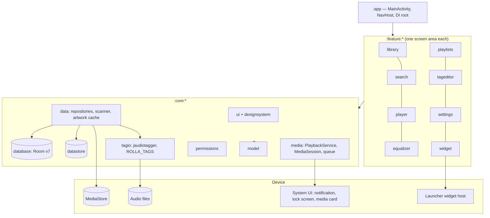

# Architecture Overview

One Android app built from Gradle modules in the "Now in Android" style ([[Multi-module architecture]]). Everything
runs on the device; there is no server.

## Layers
- **Presentation:** Compose screens and their ViewModels in `:feature:*`, built only from the tokens and kit in
  [[core-designsystem]] and the shared rows in [[core-ui]] ([[Build UI from tokens and the kit]]). MVVM with one
  `StateFlow` UI state per screen.
- **Navigation:** one `NavHost` in [[app]], type-safe routes, Home as the start destination ([[Navigation routes]],
  [[Home replaces the bottom navigation]]).
- **Domain:** plain Kotlin models in [[core-model]] (`Song`, `Album`, `Playlist`, `CustomTag`, …; [[Glossary]]).
- **Data:** repositories, the MediaStore scanner, the file pass and the artwork cache in [[core-data]]; Room in
  [[core-database]] ([[Database Schema]]); settings in [[core-datastore]] ([[Configuration]]); file tag IO in
  [[core-tagio]].
- **Playback:** [[core-media]]: `PlaybackService` (a Media3 `MediaLibraryService`), the session, the queue, queue
  save/restore and the equaliser effect ([[Playback and queue]]).
- **Widget:** [[feature-widget]] (Glance), driven by `PlaybackStateHolder` ([[Widget actions]]).

## Rules of the graph
- `:feature → :core → :core:model`; features never depend on each other; core never depends on a feature
  ([[Module dependency direction]]).
- Each module has an owning agent ([[Ownership map]], [[Agents]]).

## Cross-cutting
- **Offline and privacy:** no network code, no `INTERNET` permission, storage permission only
  ([[Offline and privacy first]], [[Permissions]]).
- **DI:** Hilt, with module-local dispatcher qualifiers.
- **Design system:** [[UI style guide]], [[One UI redesign decisions]].
- **Static analysis:** detekt, Spotless, `checkNoNetwork`, `checkNoMaterialIcons` ([[Conventions]]).
- **Logging:** Android `Log` only, never sent anywhere.

## Decisions
All architecture and product decisions: [[Decisions]].
