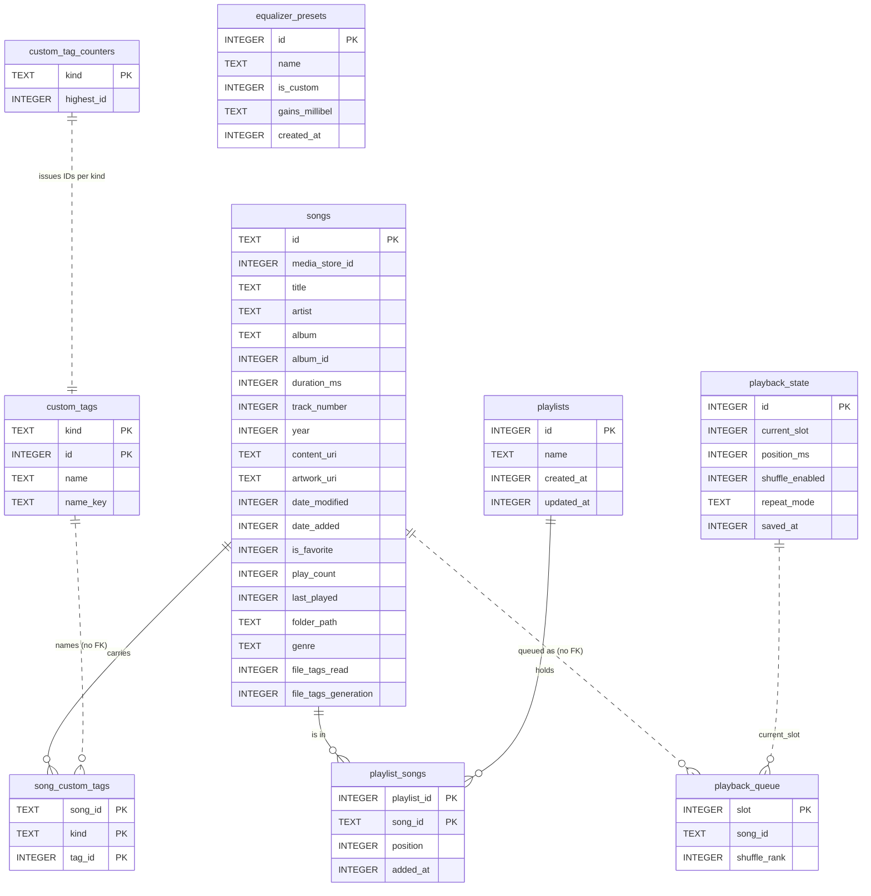

# Database Schema

Room database `MusicDatabase`, **version 7**, in [[core-database]] (owner: [[data-layer-agent]]). The exported schema
JSON in `core/database/schemas/` is the source of truth; this note is the map. Settings are not here: they live in
DataStore ([[Configuration]]). Artwork is not here either: it is a file cache ([[Per-track artwork]]).

## Tables
| Table | Entity | Holds | Model |
|---|---|---|---|
| `songs` | `SongEntity` | the scanned library, play stats, folder, genre, file-pass state | [[Song]] |
| `playlists`, `playlist_songs` | `PlaylistEntity`, `PlaylistSongCrossRef` | user playlists; links cascade on delete of either side | [[Playlist]] |
| `equalizer_presets` | `EqualizerPresetEntity` | named presets (gains as text) | [[EqualizerPreset]] |
| `playback_queue`, `playback_state` | `PlaybackQueueEntity`, `PlaybackStateEntity` | the saved queue and its single state row (`id` 0) | [[SavedPlayback]] |
| `custom_tags`, `custom_tag_counters`, `song_custom_tags` | `CustomTagEntity`, `CustomTagCounterEntity`, `SongCustomTagCrossRef` | the two tag lists, their ID counters, song links | [[CustomTag]] |

Albums, artists and folders have **no table**: they are `GROUP BY` views over `songs` ([[Album]], [[Artist]],
[[Folder]]).

## Keys and indexes worth knowing
- `songs.id` is the MediaStore id as text; `media_store_id`, `title`, `artist` and `album_id` are indexed.
- `custom_tags` is keyed by (`kind`, `id`); a unique index on (`kind`, `name_key`) blocks duplicate names per list.
- Deliberately **no foreign key** from `playback_queue.song_id` (a deleted song must restore as "missing") or from
  `song_custom_tags.tag_id` (a file may carry an ID the list does not know).

## Migrations
- Each step is a `Migration{N}To{N+1}.kt` in `core/database/.../migration/`; `ALL_MIGRATIONS` lists them oldest first
  and `DatabaseModule` installs exactly that list. `MigrationTest` replays every step from v1.
- Room exports the schema JSON to `core/database/schemas/` (`RollaAndroidRoomPlugin`). A new version adds its
  migration, bumps `version` on `MusicDatabase` and commits the new JSON.
- Destructive migration is never used: the user's playlists, favourites and play counts must survive.

| Version | Added | When |
|---|---|---|
| 1 | `songs` | v1 Phase 0 |
| 2 | `playlists`, `playlist_songs`; `songs.is_favorite`, `play_count`, `last_played`, `date_added` | v1 Phase 2 |
| 3 | `equalizer_presets` | v1 equaliser |
| 4 | `songs.folder_path` | redesign Phase 4b ([[Home and library]]) |
| 5 | `playback_queue`, `playback_state` | [[Playback queue restore]] |
| 6 | custom tag tables; `songs.genre`, `file_tags_read` | [[Custom tags]] phase 1 |
| 7 | `songs.file_tags_generation` (stale-read guard) | [[Custom tags]] phase 2 |
